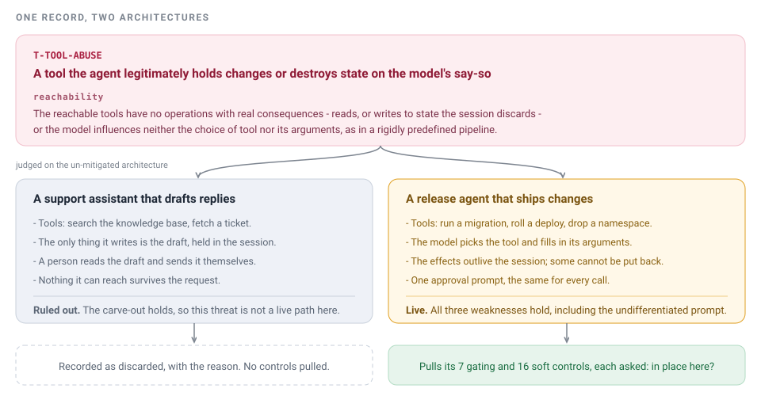

# Why Keel is built this way

Background for people who want the reasoning behind the design. You do not need this page to run Keel; [Getting started](getting-started.md) is the operational path.

A keel is the one load-bearing member that keeps a hull upright with the least material. Same idea here: the smallest structure that holds a GenAI threat model together and keeps an assessment on course.

## Two problems

**A threat model is an encyclopedia, not an engine.** It is read, not run. Nothing in it answers the only question that matters in front of a real system: is this reachable *here* at all?

**And it is someone else's encyclopedia.** OWASP did not write about your architecture. Taking it as it stands does not fit; editing it to fit turns it into your own encyclopedia within a quarter: just as dead, and now wrong as well.

The second problem is what makes the first hard. An engine over somebody's list is easy. What is hard is a list you can rewrite for yourself that does not rot while you do it.

Everything in Keel serves one of those two, and the two sections below are the two answers.

## The first answer: every threat says when it does not apply

Here is one record from the catalog, put in front of two systems.

`T-TOOL-ABUSE` is *a tool the agent legitimately holds changes or destroys state on the model's say-so*. Its `reachability` field says when that is not a live path. It opens:

> The reachable tools have no operations with real consequences - reads, or writes to state the session discards - or the model influences neither the choice of tool nor its arguments, as in a rigidly predefined pipeline.

For the support assistant, both halves hold. Its tools read; the only thing it writes is a draft that a person then sends. The threat is discarded, and the assessment records why, so the next reviewer does not re-derive it.

For the release agent, neither half holds. It can run a migration and drop a namespace, the model chooses both the tool and the arguments, and the effects outlive the session. The threat stays live and pulls its 7 gating and 16 soft controls, each of which is then asked a second question: is it in place *in this deployment*, or only in the catalog?

Every threat in the catalog carries a sentence like that, written against the system with no controls on it. That sentence is the difference between reading a list and running it.

## The second answer: it is your copy, and a change to it is a pull request

The model is YAML in git. There is no database. Every write, from the UI or the MCP tools or your editor, lands in `catalog/*.yaml` as a readable diff.

So a threat model gets reviewed the way code does: someone proposes a change, someone else reads the diff and argues with it, CI runs, it merges, and the next assessment in your organisation already uses it. That is the whole of what "the model is yours" means, and it is why the format is files rather than a product with an admin panel. The day-to-day version of this is in [Adopt Keel in your company](adopt.md).

The part of the model that makes this survive a fork is `implementations`. The shared card defines a control and how to accept it; your implementation record says how you actually built it. The two move on different clocks, and `implementations` is the last field of every card file, so an upstream edit to a card's text usually merges next to your build without a conflict. A card with no implementation recorded is treated as a recommendation rather than as cover.

## Against the existing lists

OWASP, MITRE ATLAS and CSA MAESTRO give you a shared language and stop there, which leaves both problems standing. How Keel builds on each, and the coverage table that keeps it honest, is in [Against OWASP, ATLAS and MAESTRO](comparison.md).
